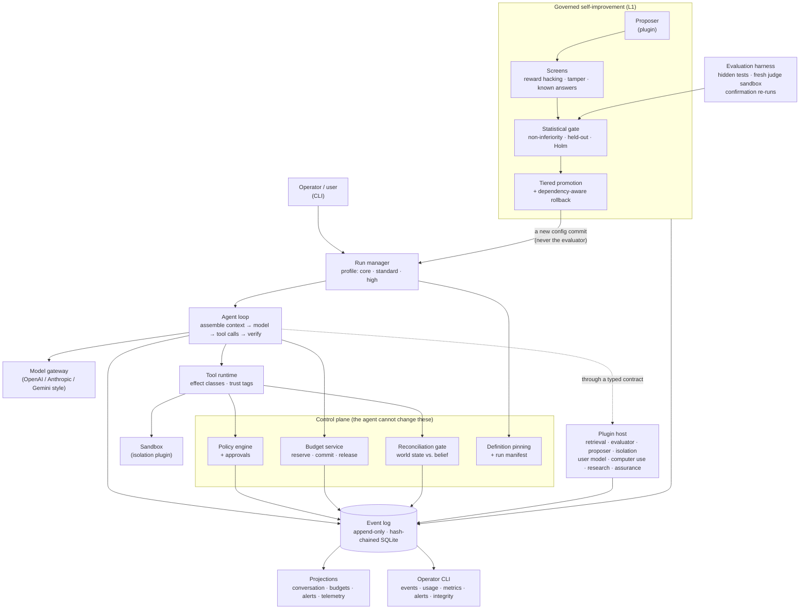

# Agent Harness

**A control plane for AI agents that makes them trustworthy by construction, and that can improve its own configuration without ever gaining authority over what judges it.**

It runs an LLM agent loop inside sandboxes, records **everything** in a tamper-evident, hash-chained event log, enforces budgets, policy and approvals **mechanically** (in code, never in prompts), and scores agent work through a hidden-test evaluation harness. On top sits a **governed self-improvement loop** that proposes edits to the harness's own prompts and playbooks, tests them statistically against data the agent never sees, and promotes or rolls them back. It is built from one language-neutral design ([`docs/design.md`](docs/design.md), traced to the requirements in [`docs/harness_intent.md`](docs/harness_intent.md)) as **two independent implementations, Python and TypeScript**, that must agree on every shared test vector and can verify each other's event logs. It was built with **AI-native development**: the requirements, decisions and acceptance came from the owner, an AI model did the implementing, and a ledger plus the tests held its claims to account ([how, below](#built-with-ai-native-development)).

| | |
|---|---|
| **Scale** | 309 traced requirements; two implementations; **Python 1,727 and TypeScript 443 passing tests**; shared vectors checked by both |
| **Status** | 86 requirements hard closed (14 verified clause by clause, 72 graded), 222 designed with code outstanding, 1 open: see [`GAPS.md`](GAPS.md) |
| **Research** | Ten sources cited by the requirements, one of which is implemented as a component runtime: see [Research foundations](#research-foundations) |

> **Read this first.** This is a reference implementation and design study: a working Train 1 *core* plus the Train 2 improvement-governance core, not the whole design. Most importantly, the only sandbox backend (`LocalProcessBackend`) runs commands **directly on your machine with path checks, and it is not a security boundary.** Do not point it at untrusted models or untrusted code. See [Known limitations](#9-guarantees-and-non-guarantees) and the [TODO list](#11-todo-list).

---

## Architecture



**Three ideas hold it together.**

1. **The log is the truth.** State (the conversation, budgets, approvals, alerts) is a *projection*, a pure function folded over events, so it can be rebuilt at any time and a crash is recovered by replaying and verifying the log. Each implementation verifies the other's log, and a golden improvement campaign produces a byte-identical hash chain in both languages.
2. **The control plane is outside the agent's reach.** Policy, budgets, definitions, the evaluator and the held-out data are not things the agent, or the improvement loop, can edit. Definitions are pinned by content hash for each run, and a mismatch stops the run.
3. **Everything that varies is a plugin behind a contract.** Models, indexes, judges, sandboxes and proposers are supplied at run time against typed interfaces with a stated error contract; the harness loads them from configuration, proves they conform, and calls them only through a handle that validates, times out, budgets and audits each call.

**How one run goes.** The run manager creates a run bound to a **profile** (`core`, `standard`, `high`), a config commit and a **manifest** that pins every definition it will use. The loop assembles context (each piece tagged `system`, `developer`, `user`, `tool_trusted` or `untrusted`), calls the model, and executes the tool calls it returns. Each call is classified by **effect** (read-only, reversible, irreversible, external) and passes through **policy**; risky ones wait for **approval**, and state-changing ones pass the **reconciliation gate**, which reads the real state before and after and never assumes that a timeout meant failure. **Budgets** (turns, tokens, time, cost, tools, submissions) are reserved before a call and reconciled after, and exhaustion is a hard stop that the log attributes to a budget. The run ends only when a **verifier** produces evidence, and the **outcome** is one of success, partial, failure or inconclusive: missing evidence is never success.

## Design principles

1. **Mechanisms over prose.** A rule that matters is enforced in code. A prompt that asks the model to behave is not a control.
2. **An agent's claim of success is never evidence.** Only a verifier's evidence completes a run.
3. **Fail closed.** An unknown tier, a missing plugin, an unreadable state, an unverified outcome, or a hash mismatch stops the work; nothing falls back to something weaker.
4. **Never assume a timeout is a failure.** Read the authoritative state before retrying, because the action may have happened.
5. **Separate who acts from who judges.** The evaluator, verifier, held-out data and gate parameters sit outside the improvement loop.
6. **Record what is unavailable; never invent it.** A manifest field is recorded, unavailable or not applicable, and a dashboard category is available or unavailable, never inferred from silence.
7. **Say what is built.** Every requirement is open, designed, or implemented, and the gaps report is generated from the ledger.
8. **One design, two implementations.** If two independent implementations agree on shared vectors, a bug in one is unlikely to hide in the other.

## Advanced topics implemented

| Topic | What is implemented | Detail |
|---|---|---|
| **Event sourcing with a tamper-evident log** | Append-only SQLite, hash-chained over RFC 8785 canonical JSON; state as a fold; cross-language verification | [§4.2](#42-event-log-and-integrity) |
| **A component calculus from a paper** | Revertible effects, fibers, reactive activation, confinement and the nine rules of the Cordis framework, **model-checked exhaustively** on small configurations | [§4.14](#414-component-runtime-prd-39-arxiv260825512) |
| **Governed recursive self-improvement** | Propose, screen, gate on held-out data, promote by risk tier, roll back dependency-aware, with a recursion cap | [below](#recursive-self-improvement), [§4.13](#413-governed-self-improvement-train-2) |
| **Statistics for trustworthy evaluation** | Paired bootstrap, non-inferiority, Holm correction, held-out query caps, and a seeded RNG (xoshiro256\*\*, SplitMix64) that gives identical results in both languages | [§4.9](#49-evaluation-harness) |
| **Budget reservation protocol** | Reserve before a call, reconcile after, release on failure; hierarchical budgets for child runs; unmetered resources named, never assumed zero | [§4.17](#417-budget-service-outcome-verdicts-manifests-and-operator-telemetry) |
| **Reconciliation against the real world** | A six-state machine with risk tiers; version-conditional execution; read-back; an unknown outcome blocks completion | [§4.18](#418-reconciliation-the-world-against-what-the-harness-believes-design-513) |
| **Outcome verdicts and provenance** | A verdict algebra with exact decimals; a run manifest that records models, config commit, limits and pinned definitions; definitions immutable by database triggers | [§4.17](#417-budget-service-outcome-verdicts-manifests-and-operator-telemetry) |
| **Evaluation integrity** | Declared test visibility, a held-out registry, and **detector-level closure** (a class is closed only when each of its detectors passes with current, independently verified evidence) | [§4.18a](#418a-projects-and-evaluation-integrity-closure) |
| **Failure taxonomy** | Version 2: a primary class and secondary tags, human override, application-defined layers, and self-modification classes with thresholds | [§4.15](#415-decisions-applied-from-the-deployment-owner) |
| **A plugin architecture** | Eight kinds, typed interfaces, an error-code catalogue with retryability, probes that prove each declared error, safe conformance on a live plugin, class loading from configuration | [§4.19](#419-the-plugin-interface-design-1811), [`docs/plugin_contract.md`](docs/plugin_contract.md) |
| **Operator telemetry** | Role-gated content, redaction, every reviewer read logged, categories marked available or unavailable | [§4.17](#417-budget-service-outcome-verdicts-manifests-and-operator-telemetry) |
| **Crash recovery** | Verify the log, rebuild state, re-run safe operations, refuse unsafe ones, preserve accounting | [§4.10](#410-crash-recovery) |
| **Requirement traceability** | 309 requirements traced PRD → design matrix → ledger → code, with hashes that make drift detectable | [§4.16](#416-closure-model-open-soft-closed-hard-closed) |

## Recursive self-improvement

The design has three levels:

| Level | What happens | Status |
|---|---|---|
| **L0** | Agents solve tasks using a configuration `C`, a git commit | Built |
| **L1** | A **campaign** improves `C`: it proposes edits, tests them, and promotes the ones that help | Built (the proposer is a plugin interface; a scripted proposer ships) |
| **L2** | Improving *the improver* | **Not built.** By design it is a human-approved meta-change |

**The governing principle is to improve the harness, never the evaluator.** A loop that optimises a signal will game it, so the evaluator, verifiers, held-out data, gate parameters, budgets, policy and sandbox settings sit outside the loop and are protected by integrity hashes. Edits are tiered by risk: **T0** context content (playbook entries, few-shot examples), **T1** instructions and tool descriptions, **T2** workflow and harness code, **T3** the improvement machinery itself (the proposer and optimiser), and **T4** the control and evaluation surface. Each tier up gets a stricter gate and more review; T3 changes only through an out-of-band, human-approved change, and the loop can never edit T4.

**What an edit must survive**
1. **Be grounded in evidence:** it traces to observed failures and carries a falsifiable prediction.
2. **Pass the screens:** reward-hacking, protected-reference and known-answer checks, and tamper checks (nine tamper scenarios are tested).
3. **Pass the statistical gate:** non-inferiority on scoring data and on **held-out** data the improver never sees, with a multiple-comparison correction (Holm) and a per-target-model check.
4. **Be promoted under review:** an automated gate for T0, a gate plus sampled human review for T1, a blocking human review for T2, and dependency-aware rollback if a promotion has to be undone.
5. **Stay inside the bounds:** budgets, a cap on held-out queries (so the loop cannot overfit to the scorer by asking repeatedly), a depth cap on recursion, and rejection of repeated proposals.

The failure modes are named and **detected**: `selfmod.overfitting`, `reward_hacking`, `diversity_collapse`, `over_optimism`, `post_promotion_regression` and `invalid_proposal` are measured against thresholds, and `implementation_drift` and `harness_adherence` are set by a reviewer's label.

## Research foundations

The requirements cite their sources once, in Appendix A of the PRD. The table gives each source, what the requirements take from it, where that shows up in the harness, and whether it is built. The sources are reported as the PRD states them, several are dated 2026, and they have not been independently verified. The column "where it shows up" is a mapping derived from reading the PRD and the design; it is not a tag in the PRD.

| Source (as the PRD cites it) | What the requirements take from it | Where it shows up | Status |
|---|---|---|---|
| *Agentic Harness Engineering*; *Self-Harness*; Weng, *Harness Engineering for Self-Improvement* (July 2026) | Keep the evaluator and permissions outside the loop; ground every edit in evidence; gate on held-in and held-out regression | PRD §6.1–6.4: improve the harness never the evaluator, the immutable control surface, evidence-grounded edits, the gate | **Built** |
| Shi, Zhang and Cui, arXiv:2608.25512, *A Programming Paradigm for Spatiotemporal Composability* | Components that carry inverses for their effects and declare dependencies give complete removal and reactive coordination | PRD §3.9: the component runtime (stages, fibers, the nine rules, confinement) and its exhaustive model check | **Built**; the closest thing here to a faithful implementation of a paper |
| Weng's open problems | Weak evaluators, memory lifecycle, negative results, diversity collapse, reward hacking | Negative-results store, novelty rejection, diversity monitor, screens, evaluator separation | **Built** |
| Zelikman et al., *Self-Taught Optimizer* | Recursive improvement helped with a stronger model and degraded with weaker ones | Recursion depth cap; per-model gating | **Partly built** (no meta-evaluation) |
| Lin et al., arXiv:2605.30621 (via Weng) | Harness-updating capability was flat across models while benefit was non-monotonic | Per-target-model validation | **Partly built** (scaffolding expiry not built) |
| OpenRSI Index and RSI-Harness | Informed the submission loop, evaluator integrity, isolation parity, brokered sandboxes, recovery accounting and teardown (the PRD notes its implementation was not verified) | PRD §3.6, §5 | **Partly built** |
| Trehan and Chopra (via Weng) | Failure modes of autonomous research: implementation drift, over-optimism, weak scientific taste | The self-modification failure classes and the review tiers (PRD §3.7, §6.11) | **Informs the screens**; no direct implementation |
| Zhang et al., arXiv:2609.35738, *Harness Learning* | An RL-trained proposer improved single-revision quality; the authors' sequential-versus-independent comparison is not compute- or feedback-matched | The `proposer` plugin kind is the extension point | **Not built** (no learned proposer) |
| SIA, WHALE, Continual Harness | Joint harness-and-weight optimisation; the PRD calls the SIA evidence provisional | | **Not built** (post-v1) |

**Techniques and standards the implementation uses.** Paired bootstrap (Efron, 1979) and Holm's sequentially rejective correction (Holm, 1979) for the accept/reject gate; xoshiro256\*\* (Blackman and Vigna, 2021) seeded through SplitMix64 (Steele, Lea and Flood, 2014) so that both languages draw identical samples; RFC 8785 (JSON Canonicalization) for hashing events; RFC 3339 timestamps; ULIDs; SQLite WAL and FTS5 (BM25). [§8.3](#83-standards-and-algorithms-the-design-cites-by-name) lists these and which are implemented.

**Related literature the design names but this build does not implement.** The multi-agent design names ReAct (Yao et al., 2022), Self-Consistency (Wang et al., 2022), Reflexion (Shinn et al., 2023) and the patterns in Anthropic's *Building effective agents* (2024). They belong to the later multi-agent train and are not built; [§8.4](#84-related-literature-for-techniques-the-design-names-without-references) lists them.

## Built with AI-native development

This project was built by directing an AI model as the implementing engineer, with the owner supplying requirements, decisions and acceptance. The method is the interesting part, so it is described here.

**Specification first.** Six PRDs defined *what* was wanted. A design document traces each of the 309 requirements to a component in a generated matrix, and the implementation follows the design, not the other way round. Delivery was split into "trains" (core, self-improvement governance, then later modules) so each could be finished and verified.

**Humans decide; the AI implements.** Where the PRDs were silent or in tension, the owner decided, and the decision was recorded ([§4.15](#415-decisions-applied-from-the-deployment-owner)): how budgets warn, how configuration is versioned, how failures are classified, how skills are trusted, whether user memory is on, how projects are identified, and how exfiltration monitoring is claimed. One decision conflicts with the PRD and is recorded as a deviation and left open instead of being quietly resolved.

**A ledger holds the AI's claims to account.** AI-generated work tends to overstate completion, so every requirement is tracked as **open**, **soft closed** (closed in design, code outstanding) or **hard closed** (implemented, with evidence), in `closure/ledger.json`. Each close is bound by hash to the exact PRD and design text it was judged against, so a later edit makes it *stale* and a checker fails until someone re-reads it. A hard close is *graded* (from the code and tests by title) or *verified* (clause by clause), and the README counts them separately: of 86 hard closes, only 14 are verified. `GAPS.md` is generated from the ledger and cannot drift from it.

**Tests are the contract.** Two independent implementations must agree on shared vectors; most Python cases are seeded random-interleaving runs; nine tamper scenarios attack the improvement loop; the event log is verified by the other implementation. The plugin contract document and the gaps report are generated and checked by tests, so documentation cannot silently go stale.

**What went wrong, and how it was caught.** AI-native development has characteristic failures, and the process exists to catch them:

* A requirement was graded as implemented when it was not; a review against the code reopened it with a logged reason.
* A plugin conformance step called every method on the live plugin, and its sample for one method deleted a document by a plausible id: caught while tracing why a test lost data, fixed with reserved ids and ids taken from what the plugin created.
* A retriever ranked a one-word document above a better match, and an evaluator adapter passed parameters in a shape its evaluator ignored, so every check came back uncertain: both caught by tests that stated the intended behaviour.
* Design text described a tier wrongly: caught by checking the claim against the source requirement before shipping it.
* Two AI sessions worked on one working tree and one overwrote a file the other had created: the file was reconstructed from the tests of the code that depended on it, and the lesson is to give concurrent sessions separate branches.

**What it shows.** Specification discipline, traceability, test design, and the habit of measuring what an AI claims against what is actually there. The ledger, the generated reports and the tests are the parts worth reusing.

## Contents
[Architecture](#architecture) · [Design principles](#design-principles) · [Advanced topics](#advanced-topics-implemented) · [Recursive self-improvement](#recursive-self-improvement) · [Research foundations](#research-foundations) · [AI-native development](#built-with-ai-native-development)

1. [What it does](#1-what-it-does)
2. [Status at a glance](#2-status-at-a-glance)
3. [Core concepts](#3-core-concepts)
4. [Functionality in detail](#4-functionality-in-detail)
5. [Quick start](#5-quick-start)
6. [Configuration reference](#6-configuration-reference)
7. [Task packages (evaluation)](#7-task-packages-evaluation)
8. [What the requirements are based on](#8-what-the-requirements-are-based-on)
9. [Guarantees and non-guarantees](#9-guarantees-and-non-guarantees)
10. [Repository layout and testing](#10-repository-layout-and-testing)
11. [TODO list](#11-todo-list)

---

## 1. What it does

| You want to… | The harness provides |
|---|---|
| Run an agent against a model (OpenAI-, Anthropic- or Gemini-style APIs) | A loop that assembles context, calls the model, executes tool calls, and repeats until a **verifier** proves the task done |
| Know exactly what happened, later | An append-only, hash-chained **event log** (SQLite). Every model call, tool call, policy decision, approval and state change is an event |
| Stop runaway agents | **Budgets** (turns, tokens, wall-clock, cost, tool calls, submissions), **stuck-loop detection**, idle-turn limits, operator **pause/kill** |
| Keep a human in control of risky actions | A **policy engine** (allow / deny / require-approval rules) and an **approval service** with expiry and standing approvals |
| Keep secrets and untrusted text from steering the agent | Secret redaction, **untrusted-content wrapping**, trust-tagged context, a memory guard against self-modifying behavior |
| Survive crashes | **Recovery**: verify the log, rebuild state, re-run safe operations, refuse to re-run unsafe ones |
| Score agent submissions fairly | An **evaluation harness**: hidden tests in a fresh judge sandbox, shaped feedback, best-of-N selection, **confirmation re-runs** with bootstrap statistics |
| Let the harness improve its own configuration, safely | A governed **improvement campaign**: propose edits to prompts/tools/playbooks, screen them, gate them statistically on scoring and held-out data, promote with tiered review, roll back dependency-aware (§4.13) |
| Check a deployment is sane | **Preflight** checks PF-01…PF-16 (plus PF-U01, PF-U02, PF-G01) per profile |

## 2. Status at a glance

| | |
|---|---|
| Implementations | Python 3.12 (`impl/python`) and TypeScript / Node ≥ 22.13 (`impl/typescript`) |
| Tests | **Python 1,727 passing, TypeScript 443 passing** (most Python cases are seeded random-interleaving runs), plus shared vectors checked by both (see [§10](#10-repository-layout-and-testing)) |
| Interop | Each implementation verifies the **other's** event log. A golden self-improvement campaign run in both languages produces a **byte-identical** event hash chain and the same `main` commit id |
| Design scope | The revised design (`design__1_.md`): Train 1 core, the Train 2 governance core ([§4.13](#413-governed-self-improvement-train-2)) **and the component runtime of the paper arXiv:2608.25512** ([§4.14](#414-component-runtime-prd-39-arxiv260825512)), as a library not yet used by the rest of the harness. Meta-change, research mode, multi-agent and the Train 4 modules are **not** built |
| Isolation | **None** for real (dev tier only). Standard/High profiles refuse to start on it. Host environment variables are **not** inherited by sandbox processes (allowlist only) |
| Not built | HTTP API, OIDC/RBAC, OpenTelemetry export, real MCP client, streaming, container/gVisor/Kubernetes/Databricks sandboxes, Rust core, background jobs, tool linting, data-flow control, backup/restore, Postgres adapter |

Every requirement is tracked as **open, soft closed (closed in design, waiting for code) or hard closed (implemented as the PRD and design say, closed for good)** in `closure/ledger.json`, and `GAPS.md` is generated from it ([§4.16](#416-closure-model-open-soft-closed-hard-closed)). Today: **86 hard closed (14 verified, 72 graded), 222 soft closed, 1 open** of 309. The graded hard closes come from the earlier gap review and have not been verified clause by clause; one of them (Agent Legibility) turned out to be a grading error and was reopened, so treat the rest as provisional; coverage below is by component.

---

## 3. Core concepts

* **Run** — one agent execution. Identified by a ULID, owned by a user, bound to a profile and a config hash.
* **Event log** — the single source of truth. State (conversation, budgets, approvals, …) is a *projection*: a pure
  function folded over events, rebuildable at any time. Nothing else is authoritative.
* **Profile** — how strict the deployment is:

  | Profile | Intended for | Sandbox tier needed | Approvals |
  |---|---|---|---|
  | `core` | local development, no external effects | T-Core (the insecure dev tier is allowed only with `sandbox.allow_dev_tier: true`) | the default Core rule allows irreversible in-sandbox actions; `external_facing` still needs approval |
  | `standard` | shared/team use | T-Std (gVisor) | required for irreversible & external actions |
  | `high` | high-assurance | T-High (microVM) | per-instance for irreversible actions; stuck loops escalate to a human |

* **Effect class** — each tool declares `read_only`, `reversible_write`, `irreversible` or `external_facing`; policy defaults hang off it.
* **Trust** — every piece of context carries `system | developer | user | tool_trusted | untrusted`. Sandbox, MCP and retrieved text is `untrusted`, and a summary of untrusted text stays untrusted.
* **Verifier** — evidence that a task is done. **An agent's claim of success is never sufficient.**

## 4. Functionality in detail

### 4.1 Run lifecycle

```
CREATED → PROVISIONING → READY → RUNNING ⇄ AWAITING_APPROVAL
                                   │  ⇄ SCORING
                                   │  ⇄ PAUSED (operator)
                                   ├→ AWAITING_HUMAN        (recovery uncertain / High-profile stuck loop)
                                   ├→ COMPLETING → COMPLETED  (only with recorded verification evidence)
                                   └→ TERMINATING → TERMINATED (kill, budget, stuck loop, fatal error, …)
                           any non-terminal → FAILED_INTEGRITY (hash chain broken)
```
Transitions are validated by a table; illegal ones raise. `COMPLETED` is *refused* by the state machine unless a passing
`verification.completed` event exists after the run entered `COMPLETING`. Termination always records `TERMINATING`
**before** doing anything else, then tears down sandboxes and revokes every grant (idempotent), then classifies the failure.

### 4.2 Event log and integrity
* SQLite in WAL mode with `synchronous=FULL`; **one writer** with group commit; callers are acknowledged only after `COMMIT`.
* Per-run hash chain: `hash = SHA-256(prev_hash ‖ 0x0A ‖ JCS(event))` using RFC 8785 canonical JSON; genesis hash derives from the run id.
* `UPDATE`/`DELETE` on events are blocked by trigger; tampering is detected by `verify` (and at recovery).
* Full-text search (FTS5, BM25) over event text powers `recall` and post-compaction hydration.
* Large/sensitive payloads live in a content-addressed blob store and are referenced by hash, so **content can be deleted without breaking the chain**.

### 4.3 Agent loop and context
Each turn: compact if needed → assemble context → check budgets → call the model → record the response → execute tools → record a turn summary → decide whether to continue.
* **Context segments** (S0 system, S1 tools, S2 skills index, S3 history, S4 working state, S5 ephemeral guidance) keep a stable prefix for provider caching; hashes are logged each turn.
* **Compaction** replaces old history with a model-written summary *as an event* (raw history is never deleted), never splits a tool call from its result, and keeps the original instruction verbatim. Old tool results are replaced by stubs retrievable through `history.get`.
* **Hydration** pulls relevant slices of compacted history back in via full-text search.
* **Working state** (`state.write`/`state.read`) and **skills** (`skill.load`, progressive disclosure) are built in.
* **Idle turns** (no tool call, no completion request) are nudged up to 3 times, then the run ends. **Stuck loops** (same actions *and* results, 4×) get guidance, then termination (or escalation in `high`).

### 4.4 Budgets
Dimensions: `turns`, `tokens`, `time_ms`, `cost`, `tools`, plus `submissions`, `concurrency`, `compute`. Warnings fire at 80%; the first five are **hard stops**
(the model is never called past the limit); `submissions` is a *guard* on the `submit` tool. Provider-reported token usage replaces the conservative estimate (`ceil(bytes/3)`)
after each call. Run time counts only active states and can exclude bounded harness-failure downtime.

### 4.5 Model gateway
One canonical message format; adapters for OpenAI-compatible chat, Anthropic Messages and Gemini. The gateway owns tool-call IDs (so replay works across providers),
downgrades JSON Schema for Gemini (and records what it dropped), retries transient errors with exponential **full-jitter** backoff, supports middleware hooks that
**fail closed** for safety checks, and never lets secrets reach logs (known values and secret-shaped strings are redacted).

### 4.6 Tools
Built in: `fs.read`, `fs.write`, `fs.edit` (unique-match edits), `fs.search`, `fs.glob`, `shell.run` (persistent session), `recall`, `history.get`, `state.write`, `state.read`, `skill.load`, `tool.search`, `submit`, `finish`.
Every call passes **validate → policy → (approval) → execute → shape**. Errors are *structured observations* the model can act on (code, category, hint, alternatives), not crashes.
Idempotent tools are retried; keyed tools retry with the same key; **non-idempotent tools are never auto-retried**. Large results are truncated with a retrievable handle.
Paths must be absolute under `/workspace` or `/scratch`; traversal and symlink escapes are rejected. MCP tool definitions are **hash-pinned**; a changed definition is blocked and logged.

### 4.7 Policy and approvals
Rules match on tool glob, effect class, profile, actor role and argument conditions (`eq, ne, in, glob, regex, lt, lte, gt, gte, exists`). **Deny beats require-approval beats allow**; no match falls back to
effect-class defaults. An approval waits for a decision from someone with the `approver` role who is **not the run's owner**; decisions are exactly-once, approvals expire, and
standing approvals are scoped by tool and arguments with an atomic use counter. Policy semantics are identical in both languages (30 shared vectors).

### 4.8 Sandboxes
Work and judge sandboxes with roots `/workspace`, `/scratch` (and `/tests` for judges only). Snapshots are content-addressed manifests with verified restore.
Egress is default-deny with host/port grants and SSRF blocking *after* DNS resolution (decision logic only; there is no proxy yet). Tier enforcement refuses a backend weaker than the profile requires.

### 4.9 Evaluation harness
`submit` → pause and snapshot the workspace → restore into a **fresh judge sandbox** with hidden tests → run steps as `candidate`/`judge` → read and validate the score report → return **only** a shaped score
(optionally a byte-limited summary the judge wrote — never raw test output). The evaluator kind is set by the control plane, not the grader. The best valid submission is selected;
**with two or more scored submissions a confirmation is mandatory** (re-runs with fresh seeds, or on a held-out set) and the reported value is the confirmed one with a bootstrap interval, the unconfirmed best score being shown only as an upper bound.
A paired bootstrap gate (xoshiro256** seeded through SplitMix64) is provided for accept/reject decisions and is bit-identical across languages.

### 4.10 Crash recovery
On restart: verify the log tail → rebuild projections → reattach sandboxes by label (or recreate from the last snapshot) → classify in-flight work:
model calls are re-issued (and still count against budgets); idempotent/keyed tool calls are re-run; **non-idempotent calls that may have run stop the run in `AWAITING_HUMAN`** with `recovery.uncertain`;
open approvals stay open; half-finished submissions resume from where they stopped; counters never reset.

### 4.11 Preflight
`PF-01…PF-16 (plus PF-U01, PF-U02, PF-G01)` check profile, sandbox tier, egress defaults, required budgets, secrets in sandbox environments, binary hash pins, policy validity, tool manifest completeness,
MCP pins, approval channels, log durability, evaluator independence, hidden-test exposure, cache scoping, retention and OIDC configuration. Failures are errors or warnings depending on the profile.

### 4.12 Observability
The log is the telemetry. Terminations are classified by a rule table (`spec/failure-rules.yaml`) into architecture / environment / tool / security / state / eval-integrity classes.
`inspect` prints a timeline; `verify` re-checks the chain.

---

### 4.13 Governed self-improvement (Train 2)
The design's recursion model has three levels. **L0** agents solve tasks with a configuration `C` (a git commit). **L1** improves `C` itself through a *campaign*. **L2** (improving the improver) is a human-approved meta-change and is **not built**.
The loop "improves what it runs on, but never gains authority over what judges it": the evaluator, verifiers, held-out data, gate parameters, budgets, policy and sandbox settings are out of its reach.

**What is built (design §17, milestones M9–M12 in part)**

| Part | Behaviour |
|---|---|
| Component registry + `PathPolicy` | `components.yaml` maps path globs to a component and tier (T0 playbooks, T1 prompts/tool descriptions, T2 scripts/skills/workflows). Longest match wins; anything unregistered, absolute, containing `..`, or the registry itself is **not editable** |
| `EditApplier` | Applies `replace` (search must match exactly once) / `create` / `delete` to a candidate git worktree via the real `git` CLI. Rejects symlink escapes, tiers above the campaign's allowance, and edits over the line cap. The proposal's tier is computed by the control plane, never by the proposer. Commits are **deterministic**: the same edit on the same base gives the same commit id in either language |
| Static screens | Declarative rules (`spec/screens.json`): known-answer echoes (hashed n-gram index, so answers never reach the loop), duplicate blocks, writes to score/report paths, references to protected locations, hard-coded instance ids/seeds, changes to T4-owned keys (model, budgets, egress, approvals…) inside configuration |
| Evaluation sets | Roles feedback/scoring/heldout/confirm/transfer/meta; disjointness and near-duplicate rejection; a **held-out query cap** (default 20) after which a set is exhausted; reproducible seeds `SHA-256(campaign:round:candidate:set)` |
| The gate | Paired bootstrap (§13.7) on target, guardrails, preserved behaviours (non-inferiority plus strict `must_pass`), both the canonical and format-varied variants, then a single held-out query, per target model, with a **Holm adjustment** across a round's candidates and a Pareto-dominance check |
| Archive and search | Novelty rejection (5-shingle Jaccard ≥ 0.8), parent weights `softmax(score/τ)/(1+children)`, Pareto front, diversity monitor |
| Promotion | T0 immediate; T1 immediate plus a sampled review whose rejection **automatically rolls back**; T2 needs a High-assurance deployment flag, a blocking approval by an `approver` who is **not the campaign owner**, all attachments, then a **canary** (a hash of `run_id` sends ~10% of new runs to the new commit). A stale base is never merged: the edits are rebased and the gate runs again |
| Rollback | `RevertPlanner` decides whether later promotions are independent (disjoint paths and no `requires`/`provides` link). Independent: revert alone. Dependent: `revert.blocked`, or cascade in reverse order |
| Monitoring | `PromotionMonitor` compares post- and pre-promotion cohorts with the §13.7 interval; breach means rollback for T0/T1 and an alert for T2 |
| `CampaignController` | `CREATED → PREPARING → rounds (MINING → PROPOSING → EVALUATING → GATING → PROMOTING) → STOPPED`, budgets with an 80% warning then a hard stop, plateau and `rounds_max` stops, a **recursion depth cap** (inner campaigns are dry runs that cannot promote), and an integrity check of the improver and control repositories **before every gate** (a change aborts the campaign as `eval_integrity.tampering`) |

**Crash safety.** Every campaign step is idempotent by event key and budgets are a fold over events. The test suite kills the controller at **every one of the 49 event boundaries** of a reference campaign and requires the resumed run to match the uninterrupted one: same `main` commit, promotions, budget use and held-out usage, no duplicate events.

**What is NOT built.** The model-driven parts are *interfaces*, not implementations: `proposer.propose(round, n, base, ctx)` and `observer.scores(commit, role, variant, model, seed)`. Weakness-analysis agents, trace export, pattern clustering, LLM proposal runs with a `proposal.submit` tool, the optimizers, `MetaEvaluator`/meta-change, scaffolding expiry, and research mode do not exist. The tests drive the machinery with a scripted proposer and a **simulated** environment whose scores depend on the content of the edited files; nothing here has been run against real models.

**Gate policy per kind of edit.** Each tier has its own gate settings, with defaults chosen by the deployment owner and an **administrator override per environment**, stricter or leaner:

| Tier | Statistical gate | Human review | Canary |
|---|---|---|---|
| T0 (playbooks, memory) | alpha 0.05 | none: promoted as soon as it passes ("immediate") | none |
| T1 (prompts, tool descriptions) | alpha 0.05 | sampled (20% of promotions, 72 h window) | none |
| T2 (scripts, skills, workflows) | alpha 0.01 | **blocking** approval by an independent approver, and a High-assurance deployment | 10% of new runs |
| T3 and above (optimizer code and up) | never promoted by the loop | human-approved only | n/a |

Configuration (YAML or JSON handed to `GatePolicy.resolve(config, environment)`):
```yaml
gate:
  tiers:                       # base overrides, applied to every environment
    T1: {alpha: 0.04}
  environments:
    prod: {tiers: {T1: {alpha: 0.01, review: {mode: blocking}}, T2: {alpha: 0.001}}}   # stricter
    dev:  {tiers: {T1: {alpha: 0.2,  review: {mode: none}}, T0: {holm: false}}}        # leaner
```
Per tier you can set `alpha`, `B`, `holm`, `margins`, `heldout_margin`, `preserved_margin`, `review.{mode: none|sampled|blocking, sample_rate, window_h}` and `canary_fraction`. Precedence is default, then base `tiers`, then the named environment. The policy is **validated**: unknown settings and tiers are refused, values must be in range (so a typo such as `alpha: 0` is rejected, since it would make the gate unpassable), and **T2 cannot be made non-blocking**. Every deviation from the defaults is listed with its direction (`stricter`, `leaner` or `changed`); the resolved policy, its SHA-256 fingerprint, its environment and the diff are recorded in `campaign.created`, and a leaner-than-default policy additionally emits a `policy.relaxed` event so reviewers can find it. Holm's adjustment is applied *within* a tier, because each tier has its own alpha. The policy is shared by both implementations (`spec/vectors/selfimprove-policy.json`).

**Where the design was silent, I chose** (recorded in the code and fixed by shared vectors): Holm is applied to the *target* test per model and per tier, ordered by a one-sided bootstrap p-value; guardrail, preserved-behaviour and held-out checks are non-inferiority checks at the nominal α; the answer-echo screen indexes 5-word spans; the monitor pairs its two cohorts by position after truncating to the shorter.

---

### 4.14 Component runtime (PRD §3.9; arXiv:2608.25512)
PRD §3.9 takes its requirements from *A Programming Paradigm for Spatiotemporal Composability* (Shi, Zhang and Cui, Peking University and DeepSeek-AI), which defines the Cordis framework. Its idea: **temporal composability** (removing a component fully reverses what it did) comes from *revertible effects*, where every change returns an inverse the runtime holds; **spatial composability** (components declare dependencies and are activated and deactivated reactively) comes from *reactive coeffects*; both are mediated through one context, and a calculus of **fibers** carries the guarantees from one component to a whole interleaved system. The complete paper (all 83 pages: the calculus, the metatheory, the Cordis implementation and the discussion) was read for this implementation.

| Paper | Code (`harness.components` / `src/components`) |
|---|---|
| effect function with a witnessed inverse (Def. 8); accumulator applied last-in-first-out (Def. 18, Thm. 16) | stages `Provide` / `Operate` / `Instantiate` / `External`; `Fiber.acc`; `World.perform` for effects after activation (Cordis `ctx.effect`) |
| effect iterator (Def. 17) | a generator: each `yield` is one iteration and the value sent back selects the continuation |
| coeffect context, specification, `notify` (Def. 19-22) | the tables of *active* fibers; `requires` / `provides` with version ranges; `notify` |
| isolation and interception (Def. 24-27; Cordis `ctx.isolate`, `ctx.intercept`) | `Scope.isolate` / `Scope.intercept`, derived contexts that change nothing in the shared table |
| component, fiber, registry (Def. 48-50); Cordis lifecycle names (Table 2) | `Component`, `Fiber`, `World`; `Fiber.state` is INACTIVE, LOADING, ACTIVE, UNLOADING or FAILED |
| the nine rules and the guard (§4.2) | `World.insert/retire/remove` and `World.step` (begin, iter/finish, divert, leave, unload) with `relied` |
| independence and commutativity witnesses (Def. 42-46, Thm. 43, 47) | `KeyType.commutative`, `World.independent`, `plan_revert` / `revert` |
| confinement (Def. 55); Cordis `INACTIVE_ACCESS` / `UNDECLARED_ACCESS` (Alg. 6) | undeclared reads and writes refused, recorded once, fiber quarantined; `InactiveAccess` for a declared key that is not committed |
| totality on provision (Def. 76) | detected at every finish (`not_total`), optionally enforced (`require_total`) |
| failure extension (§4.4) | an effect that raises, including before its first yield, quarantines the fiber as FAILED; it is not retried against an unchanged environment |
| declarative entries and loader (Def. 81, §5.2.1) | `Entry` and `Loader`: per-field dispatch (id/url rebuild, isolate and intercept in place, config handed to the component, disabled), groups reconciled by keyed diff |
| hot module replacement (Alg. 8-10) | `classify`, `get_dependencies`, `detect_stale`, and a transactional `hot_reload` that restores the previous system if an import fails |
| service broker, access control (§6.2, §6.3) | `broker_key` and `Broker` (rolling updates without reloading consumers); a load-time `review` hook over each component's declared capabilities; policy by interception |

```python
from harness.components.core import Component, Operate, Provide, World
from harness.components.keys import table_key
w = World({"ns/routes": table_key()})
web = Component("web", lambda c: [Provide("ns/routes", {})], provides={"ns/routes": "1.2.0"})
def api_effects(c):
    yield Operate("ns/routes", "add", ("r1", "GET /a"))
api = Component("api", api_effects, requires={"ns/routes": "^1.0.0"})
a = w.insert(api); w.settle()      # stays INACTIVE: nothing provides ns/routes yet
p = w.insert(web); w.settle()      # web activates, then api activates (a `notify: activating` event)
w.retire(p); w.settle()            # api is unloaded FIRST (the guard), then web; every entry is reverted
```

**Also built for the PRD:** a registry that rejects non-namespaced keys, bad version ranges, overlapping provisions (unless isolated) and dependency cycles (and `World.dependency_cycles` reports cycles among loaded components); a reconciler; **live replacement** with **run pinning**; **compensation** for external effects (withheld until approved, or compensated in reverse order; a failed compensation escalates instead of being dropped); and **stated equivalences** per resource class.

**How it is verified.** The paper's theorems are checked by a monitor (`harness.components.invariants`) on **every step** of every random run, in both languages:

| Statement in the paper | Check |
|---|---|
| Def. 63 and Thm. 64 (preservation) | all four well-formedness clauses after every step |
| Lemma 59, Table 1 | which fields each rule may write: tables move only inside a state map and only at keys the acting fiber declares; the committed view is constant inside an episode; installation changes only at begin and unload; parent, declarations and effect function are never rewritten; retirement is monotone |
| Thm. 68, Cor. 69 | after an unload the fiber's table is empty; reverting every consumer empties every provider table |
| Thm. 70 (ordering) | a binding a committed view names stays bound while its consumer is installed; the provider's episode opens before and closes after each consumer's |
| Thm. 71 (resolution coherence) | an iteration runs only while the target view still equals the committed view |
| Thm. 73 (progress) | not quiescent implies some rule applies; **S(n) ≤ (K+3)(V(n)+1)** for every fiber |
| Thm. 80 (confluence) | the state a dynamic run settles in equals the **statically assembled** one (same orchestration steps first, then settle); schedules of the same input agree |

The inputs are three scenario families: flat systems, systems whose components **instantiate children** (compared up to renaming and vestigial entries, Lemmas 61 and 62), and systems whose **providers are replaced under running consumers**. Per language: 400 + 300 + 200 seeded runs in the suites, each with the full monitor. *Mutation checks* show each check can fail: no guard, a fiber that can never leave, an iteration against a stale resolution, an accumulator never applied, and a history-dependent target (only the replacement family exposes the last, which is why it exists) are each caught. A wrong-order revert is caught by a dedicated test, because commuting effects do not detect it (Theorem 43). Three **golden vectors** of 60 scenarios each (`components-scenarios`, `-tree-scenarios`, `-replacement-scenarios`) are reproduced exactly by both languages (identical trace hashes). An **exhaustive bounded model check** (`harness.components.model`, Python) explores every interleaving for **all 400 configurations of 3 components and 2 keys (151,680 states) with no violation**; a larger run of 4 components over 1,500 configurations (5.9 million states) also found none, and it finds the planted bug when the guard is removed.

**Where this differs from the paper or from Cordis** (each noted in `core.py`): the last iteration of an iterator is merged with L-Finish; L-Divert takes the *aborting* alternative (the paper's progress theorem never relies on it, and its §4.4 "inertial" asynchronous host is **not** implemented, the runtime is synchronous); an effect function is the closed stage form of Definitions 30 and 56 plus `perform`, whereas Cordis's `ctx.effect` accepts any callback with an unchecked inverse; a component reads only keys it declares, whereas Cordis's property access (Alg. 6) walks up the fiber chain to ancestors' committed views; version ranges and namespaced keys come from the PRD (Cordis uses host-language peer dependencies, §6.6); isolation and interception are realised at the value-access layer, and **managed realms with delimiters (Algorithm 7), realm-moving of bindings, `@cordisjs/include`, and the Proxy-based context are not implemented**; cross-process brokers, the sandbox bridge (§6.3) and compile-time dependency checking (§6.4) are not built.

**What this does not establish.**
* The theorem checks are *executable readings* of the paper's statements over the runs tried, not proofs. They found no counterexample across 2,000+ monitored runs and the bounded model check, but nothing here is machine-checked in a proof assistant, and the model check is an explicit-state search over an abstraction of the rules in Python only (not TLA+, and it does not check the TypeScript code).
* The theorems assume every key is **commutative** (Def. 46). The runtime also allows non-commuting keys (an ordered chain, a setting), for which it falls back to last-in-first-out reverts inside one fiber and refuses or cascades out-of-order reverts across fibers; the global guarantees are only claimed for commutative keys.
* **Compensation uses a coarser equivalence** than the paper's observational one, so, as the paper says (§6.1), the commutation results are not re-proved for compensated effects.
* **The rest of the harness is not built on this runtime yet.** Sandboxes, grants, timers, sessions and tools still manage their own state and teardown, so the PRD's "every change to harness-owned state goes through the component's context" is met by the runtime, not by the harness as a whole.

### 4.15 Decisions applied from the deployment owner
These behaviours were chosen by the deployment owner (the questions and defaults are in the conversation history of this project); this table says what the code does.

| Decision | Behaviour |
|---|---|
| Configuration versioning: git | `config_repo`: a run records the git commit (suffixed `+dirty` for uncommitted changes). `PF-G01` refuses a dirty tree on Standard and High, warns on Core, and warns when no repo is configured. `read_at` returns a file as it was at a commit |
| Failure classes: defaults, plus application classes owned by the agent developer | Taxonomy version 2: one primary class (how the run ended) and secondary tags (other classes seen earlier), a human override (`failure.reclassified`, audited), a fingerprint of the taxonomy that classified the run. Developers add classes as `<layer>.<class>` in files in `spec/failure-rules.d/` beside `failure-rules.yaml` (`app.yaml.example` shows the shape). A layer may not reuse a core name and may only emit its own classes; core rules are evaluated first |
| Self-modification classes | Six detected automatically against thresholds (`selfmod.invalid_proposal`, `post_promotion_regression`, `overfitting` at a scoring-to-held-out gap above 0.10, `reward_hacking` when a screen fires, `diversity_collapse` above 0.60 mean similarity, `over_optimism` when an accepted lower bound is under 0.005); `implementation_drift` and `harness_adherence` are set only by a reviewer's label. Observations are `failure.observed` events |
| Evaluation-integrity classes | The feedback byte cap holds and records `eval_integrity.over_granular_feedback` when it cuts text; the number of held-out queries a set has served raises `eval_integrity.selection_bias` at 80% of its cap |
| Public tests | A public task must declare `purpose: development`, cannot use `heldout_set` confirmation, and its reports are stamped `generalization_claim: false`; its instances cannot be registered as held-out, confirm, transfer or meta sets |
| Skills and working state | Skills from the reviewed config repo are configured-trusted. `skill.load_untrusted` (agent-written or third-party skills) returns untrusted content and needs approval. Working state is untrusted when read back |
| Memory write path | Administrator-configurable (`memory.write_path`); behaviour-changing paths are always refused |
| User memory | An agent-deployment decision: off by default; `PF-U01` refuses enabling it until the store is built |
| Harness changes are behaviour | `harness.reports` compares runs only on the same config commit, models, task and grader, refuses to aggregate incomparable runs unless asked, and then marks the result non-comparable |
| Budgets | Limits come from the agent's configuration; the harness enforces them, warns at a configurable fraction, and records which budget ended a run |

**Accepted deviation.** PRD §6.5.1 says every prompt change, by a human or the loop, must pass the gate and that unevaluated trial-and-error prompt editing is not permitted. The owner decided that hand-written prompts are the human's responsibility, so the harness does **not** gate human edits. This is recorded as a deviation, not as conformance.

**Not covered.** There are no automatic detectors for state carry-over between evaluations, budget or clock reset after recovery, or stale grants; public tests are not mounted read-only in the agent's workspace (the workspace is not seeded yet); the memory screen is regular expressions only and there is no "out of character" detection; there is no CLI or UI to submit reviewer labels, reclassifications or memory-write confirmations; and the promotion monitor does not yet emit `post_promotion_regression` observations on a schedule.

### 4.16 Closure model: open, soft closed, hard closed
Each of the 309 requirements in the PRD (the design's traceability matrix has the same 309) is in exactly one state, kept in `closure/ledger.json` and checked against `docs/harness_intent.md` and `docs/design.md`.

| State | Meaning | Needs |
|---|---|---|
| **Open** | The design does not close the requirement: it is missing, deviates from the PRD, rests on an undecided question, or lags behind the code | A stated reason |
| **Soft closed** | **Closed in the design, waiting for implementation in code.** The code is partial, absent, or *needs update* (it was built against an earlier version of the requirement or design) | The design sections resolve; a note |
| **Hard closed** | **Implemented as the PRD and the design say, and closed for good** | Evidence, and a verification level (`verified` clause by clause, or `graded` from a review) |

**The rules.**
* **Order.** A requirement moves open, then soft, then hard. It cannot be hard closed without first being closed in the design.
* **A hard close is bound to what it closed.** It records SHA-256 hashes of the requirement text and of the design sections it cites (a section includes its sub-sections; a chapter-level reference such as `§9` takes only the chapter's introduction, so a new sub-section elsewhere does not disturb it). Nothing changes it silently. If either document changes afterwards, `check` reports the close as **stale**.
* **Permanent means explicit.** A reviewer either **re-attests** a stale close (reads the change and confirms the code still conforms; the close stays hard) or **reopens** it to soft or open with a reason. Both are appended to the entry's history, which is never edited or removed.
* **A refused transition changes nothing.** Every transition validates before it mutates.
* **`GAPS.md` is generated** from the ledger (`report`), and a test fails if it is out of date or if the ledger disagrees with the documents.

```bash
cd impl/python
PYTHONPATH=src python -m harness.closure check [--fail-on-stale]     # validate the ledger against the PRD and design
PYTHONPATH=src python -m harness.closure report --out ../../GAPS.md  # regenerate the report
PYTHONPATH=src python -m harness.closure soft   <id> --by ann --note "design section written" --code partial
PYTHONPATH=src python -m harness.closure hard   <id> --by ann --note "implemented" --evidence test:impl/python/tests/test_x.py::test_y
PYTHONPATH=src python -m harness.closure reattest <id> --by carol --note "read the change; code still conforms"
PYTHONPATH=src python -m harness.closure reopen <id> --by bob --reason "requirement rewritten" [--to open]
```
**How the first state was assigned (2026-10-21).** Code status came from the earlier gap review, plus a grading of 24 self-improvement requirements that review had missed. A requirement graded implemented stayed hard closed unless its text, or original lines of a cited design section, changed since that review; pure additions to a section did not reopen it. Thirteen went back to soft for that reason (the context assembler and *Durability & Resumption*). Sixteen are open: ten because the code implements owner decisions that the design does not yet describe, six because a decision is still needed (project identification for two requirements, the evaluator types, three container-backend design tensions, design deviation V1, and the hand-written-prompt deviation from the PRD). Each reason is in `GAPS.md`.

**Limits.** 72 of the 86 hard closes are *graded*, not verified clause by clause, so treat them as provisional (a verification pass promotes them). That caution is earned: the first review graded by title, and *Agent Legibility* was marked implemented when neither language has any legibility check. It was reopened with a logged reason when the ledger flagged it stale. Fifty-six soft closes rest on a design parameter that is still *proposed* and unconfirmed (marked ★ in the report). Because the hash covers exact text, an unrelated edit to a cited section makes a hard close stale until it is re-attested; that is the price of permanence. The module is Python only: it is project governance, not runtime behaviour.

### 4.17 Budget service, outcome verdicts, manifests, and operator telemetry
**Budget service (design §7.4.4).** A model call reserves its worst case (input estimate plus `max_output_tokens`, with a `budgets.safety_margin` of 5% on cost) before it runs, then commits what it used or releases the rest. Reservation is atomic, so concurrent callers cannot claim the same remainder. A call that may have reached the provider (`gateway.connection`) is charged at its estimate and flagged *unreconciled* until the real usage is known; a call that provably did not run is released. Local allocations give an agent a guaranteed share of the workflow budget, and total consumption can never pass the global limit. A submission is reserved and recorded before scoring starts. Crash recovery settles any reservation a crash left open, and a run that ends holds none. Tool calls pass through a bounded worker pool and queue (`budgets.workers`, `budgets.queue`), and while compute is unmetered it is declared so in the manifest and bounded by independent safeguards (preflight `PF-B01`): turn and wall-clock limits, the bounded pool, per-process CPU and memory limits (`sandbox.limits`), and killing everything a run started when its sandbox is destroyed.

**Outcome contract and verdicts (§13.11).** Every evaluation run is judged by a contract fixed before it starts (`outcome:` in `task.yaml`, or one implied by the pass threshold). Verdicts are derived only from evidence: a failed required criterion gives PARTIAL when another passed and FAILURE otherwise; any required criterion without verified evidence gives INCONCLUSIVE; SUCCESS needs all of them. An adapter that is missing or errors is "unavailable", never a pass. Money is compared as exact decimals. `outcome.evaluated` and a deterministic `trajectory.analyzed` (steps, tool errors, retries, budget use, denials, approvals, safety events, stuck loops) are recorded separately, and `harness` reports outcome rates with a documented denominator.

**Manifest and pinning (§13.9).** Definitions (system prompt, every tool manifest, skills, budget policy, workflow, tier policy, the evaluator rubric) are published as immutable hashed versions (the database refuses updates and deletes; floating aliases such as `latest` are rejected). `run.created` carries the manifest, `run.finished` the final fields and `manifest_hash`, and every field is `recorded`, `unavailable`, or `not_applicable`. The loop resolves its prompt, tools and skills only through the manifest and verifies them at start; a mismatch ends the run with `definition.mismatch` before any model call, and nothing is substituted. Only an audited `definition.migrated` moves a pin. A task's `test_visibility` declaration (policy) is recorded apart from what was verified about the environment (`test_visibility.verified`, `test.exposed`).

**Operator telemetry and selection alerts (§14.4, §15.2, §9.13).**
```bash
harness events  --db log.db --run <id> [--type T] [--errors] [--role operator|reviewer|admin --who NAME] [--json]
harness usage   --db log.db --run <id>
harness metrics --db log.db --run <id>          # turns, tool failures, latency histogram, tokens, cost, retries, approvals, budget terminations, stuck loops, evaluation-integrity events
harness alerts  --db log.db [--run <id>]
harness inspect --db log.db --run <id> --telemetry   # each category marked available or unavailable
```
An `operator` sees metadata and codes with message and tool content gated; a `reviewer` or `admin` sees content, and each such read is logged in `content_access`. Everything is redacted. The role is a flag, not an authenticated identity, so this is not yet real access control. A category is unavailable when this build does not collect it, never because events happened to be absent. Selection errors (unknown tool, invalid arguments, policy denial) feed a rolling window (`alerts.selection`: window 200, minimum sample 30, warn 5%, critical 10%, all proposed and unconfirmed); a sustained breach is one `alert.raised`, an easing breach is silent, and recovery gives `alert.resolved`. A selection that reaches execution without authorization is an immediate security alert.

### 4.18 Reconciliation: the world against what the harness believes (design §5.13)
A tool that declares a `world` block in its manifest (`adapter`, `resource_arg`, `preconditions`, `expected_effects`) goes through one gate in `ToolRuntime` that the agent cannot skip. Today only `fs.write` declares one; other consequential tools need an adapter and a block before they are covered.

| Step | What happens | If it fails |
|---|---|---|
| Authorize | The action is permitted, and any approval is still current (default window 900 s, proposed and unconfirmed) | `action.blocked` |
| Read | Authoritative state of the resource, through its adapter | blocked `world_state_unavailable`; the action does not run |
| Check | Preconditions, and the version the agent assumed, if it gave one | blocked `precondition_failed` or `stale_state` |
| Act | Under a version-guarded lock: the state is read again and must still be what was checked | blocked `stale_state` |
| Read back | The state after the action is compared with the expected effect | `reconcile.effect_mismatch`, or recorded `unknown` if it cannot be read |

Every subject has one of six states (`consistent`, `drift_detected`, `reconciling`, `blocked`, `unknown`, `recovery_required`), changed only by logged `reconcile.state_changed` events. `unknown` never becomes `consistent` without an authoritative read, and a run is not completed while any effect is unverified. **A timeout is not a failure:** the resource is read before anything is retried, so an action that took effect is not repeated, one that did not is retried, and one whose state cannot be read is left `unknown` and not retried. **Recovery** does the same for a call that was running when the process died. The risk of an action follows its effect class (`read_only` low, `reversible_write` medium, `irreversible` and `external_facing` high), and `reconcile.critical_tools` marks a tool critical, which also requires a human approval. Limits: the guard is a process-local lock and a re-read, not a storage-level conditional write; nothing reconciles on cancellation or on an out-of-band change; and no periodic drift check exists.

### 4.18a Projects and evaluation-integrity closure
**Project identification** (design §7.3.10). The harness never infers whether a run belongs to a project. With `memory.project.enabled: true`, a run is refused (`ProjectNotDeclared`) until the user has answered: pass `project="alpha"` or `project=None` to `create_run`, or pass `ask_project=<function>` and the harness asks "Is this work part of a project?". The answer is recorded in the manifest as `project {id, declared_by: user, asked}`. The project memory store itself is not built.

**Evaluation-integrity closure** (design §15.6). Each integrity class is closed through its **detectors**, listed in `spec/integrity/detectors.json`. A detector has one of seven states (`NOT_RUN`, `OPEN`, `FIXED_PENDING_VERIFICATION`, `PASS`, `FAIL`, `WAIVED`, `NOT_APPLICABLE`) and changes state by an `integrity.detector_status` event. A `PASS` needs evidence for the detector's current version and an evaluation run, and after a fix a verifier who is not the person who made it. A waiver needs a rationale, an approver who is not the owner, and an expiry, and an expired waiver reopens the detector. A class is `CLOSED` only when every required detector passes with current evidence, `CLOSED_WITH_WAIVERS` when unexpired waivers cover the rest, and `OPEN` otherwise; `NOT_RUN`, `WAIVED` and `NOT_APPLICABLE` never count as a pass. `harness integrity --db <db> [--run <id>] [--max-age-s N] [--json]` prints the derived status and any refused events. **Nothing in the harness records detector status from its own checks yet, so all six classes currently read `OPEN`**, which is the honest state.

### 4.19 The plugin interface (design §18.11)
The harness core ships no capability that needs a model, a corpus, a browser, a container host, or special hardware. Each of those is a **plugin**, loaded at run time against a contract that the harness defines in `spec/plugins/kinds.json` (shared by both implementations). `harness plugins --methods` lists every kind and what it must implement.

| Kind | Supplies | Needs |
|---|---|---|
| `proposer` | Model-driven self-improvement | Core; a model |
| `retrieval` | Knowledge retrieval | Core; an embedding model and an index |
| `user_model` | User modeling and prediction | Standard; user data and models |
| `computer_use` | A virtual display | Standard; a browser or desktop, a vision model |
| `research` | Research mode in an isolated fork | High-assurance |
| `isolation` | A container, microVM or other isolation backend | Core; a container host |
| `assurance` | Attestation and brokered child sandboxes | High-assurance |
| `evaluator` | Evaluation of one criterion (below) | Core; a model for two of the three types |

**Writing one.** A plugin has a manifest (`id`, `kind`, `version`, `interface_version`, `trust`, `grants`, `entry`) and implements `describe`, `health`, and its kind's methods. In Python a method takes keyword arguments and in TypeScript one params object; either may be async. List it in the configuration and it is loaded at startup:
```yaml
plugins:
  load:
    - {id: my-index, kind: retrieval, version: 1.0.0, interface_version: 1.0.0, trust: in_process, entry: {module: my_pkg.index, factory: make}}
    - {id: my-vm, kind: isolation, version: 1.0.0, interface_version: 1.0.0, trust: subprocess, entry: {command: ["./my-vm-plugin"]}}
  required: [retrieval]           # preflight PF-P01 fails if a required kind is not loaded and active
  trusted_in_process: []          # Standard and High run plugins out of process unless listed here
  max_failures: 3
```
You can also name an **implementation class**, like a Java class in a configuration file: `entry: {class: "my_pkg.index:MyRetriever", config: {id: my-index, version: 1.0.0}}`. The class must implement the kind's interface (`harness.plugin_api`: `Retriever`, `UserModel`, `ComputerUse`, `ResearchRunner`, `IsolationBackend`, `Assurance`, `Evaluator`, `Proposer`), or it is refused and nothing is registered, and a class that leaves a method unimplemented cannot be created. **`docs/plugin_contract.md`** states, for every method, what it returns and which errors it may raise, with a probe for each (generated from the spec by `harness plugins --contract`). A plugin signals an expected failure by raising `PluginRejection(code)`; the harness throws `PluginRejected` (with the code and whether it is retryable) for a declared code, `ContractViolation` for an undeclared one or a bad shape, `PluginFailed` for any other exception, and `PluginTimeout` for a slow call. With `plugins.verify_errors: true`, the host runs every probe when it loads a plugin and refuses one that does not signal what its contract says. Loading runs each method with a sample on the live plugin, so samples that change state use reserved ids (`__conformance_doc__`) and never real data.

**Where the harness uses plugins (Python only so far):** the campaign's proposer (`PluginProposer`), the `retrieve` tool (untrusted results, with the harness re-checking every passage's permissions), criteria verified by an `evaluator` (gated by independence, recorded as `evaluator.verdict`), and the tier gate (`provision_for_tier`, which refuses a sandbox that does not show every required setting). Reference plugins ship for evaluators (code, LLM judge, typed AI), retrieval (keyword), the proposer (scripted) and the user model (counting). TypeScript has the host, the contracts and the error contract, but not these consumers or the reference plugins.

A **subprocess** plugin can be written in any language: it reads one JSON request per line on stdin (`{"id","method","params"}`) and writes one JSON response per line (`{"id","result"}` or `{"id","error":{"code","message"}}`). The test suite drives a Python plugin script from the TypeScript host to check that.

**What the harness does with it.** Loading verifies the manifest and the profile policy, then calls every method with its sample input and checks every answer against the contract, so a plugin that does not conform is never registered. Every call afterwards goes through a handle that validates the input before the plugin sees it and the output before the harness uses it, applies a timeout, charges the run's tool budget, and records `plugin.called` or `plugin.failed` without the payload. What a model or an index produced is marked untrusted. Three consecutive failures quarantine the plugin. A run pins each loaded plugin as a definition, so a plugin swapped or removed during a run ends it with `definition.mismatch`. A plugin is a component of the component runtime, so a feature that needs one activates when it is loaded and deactivates when it is removed.

**Evaluators are plugins** (design §13.4). An evaluator declares one of three types: `code` (a deterministic script), `llm_judge` (a model scoring against a rubric), or `typesafe_ai` (a model whose output is a typed verdict). All answer `evaluate(criterion, subject, evidence)` with `PASS`, `FAIL`, `PARTIAL` or `UNCERTAIN`, reason codes and evidence references. A model-based evaluator must declare the `model_ref` and `credential_ref` it uses. The harness *derives* its independence from the agent under test and never accepts a declared level: `deterministic` for code, `independent_model` only when the model, the context and the credential all differ from the agent's, and `same_model_low_independence` otherwise, with the shared dimensions recorded. Core only labels the level; Standard lets an evaluation gate a promotion, release or claim only at `deterministic` or `independent_model`; High also needs a claim resting on an independent model to be backed by a deterministic check or a second independent evaluator. Not yet wired: an evaluator's verdict into outcome verification and the report's `evaluator.kind`.

**Exfiltration monitoring is partial in the core** (design §10.6). The core claims partial conformance. It does not guarantee inspection of encrypted payloads, and payload inspection is a conditional capability of the `isolation` plugin. `exfiltration_claim(observed)` derives the claim from what the plugin demonstrates: the claim is `payload_inspection` only if the plugin's verified settings include an `egress_inspection` record with a named inspection point, `policy_applied` and `audit_records` true, documented `coverage_gaps` and `bypass_conditions`, and `verified` true. Supporting TLS interception is not enough, and there is no "complete" claim. The core's own network-level monitoring and enforcement are **not built yet** (egress grants are recorded and nothing enforces them), and the claim is not yet recorded in the manifest or reported by preflight.

**What is not built.** No plugin ships with the harness. The interface and the host are built and tested with fakes; the consumers are not yet connected: the self-improvement campaign does not yet take its proposer from a `proposer` plugin, there is no `retrieve` tool over a `retrieval` plugin, and the `isolation` plugin's `verify` is not yet compared with a tier's required settings before a workload starts. The 109 requirements that depend on a plugin are tagged in `GAPS.md` (⧉) and stay open until a conforming plugin is loaded and its consumer is wired; the `proposer` tag covers all model-driven self-improvement items, which is an approximation.

---

## 5. Quick start

**Requirements:** Python ≥ 3.12 and/or Node ≥ 22.13 (TypeScript uses the built-in `node:sqlite`, which prints an "experimental" warning; no native build). **Developed and tested on Linux only** — the shell-session helper relies on GNU `base64 -w0`, so macOS is untested and likely to need a fix; Windows is unsupported.

```bash
# Python
cd impl/python && pip install -e '.[dev]' && python -m pytest -q
PYTHONPATH=src python -m harness.cli demo        # scripted agent, no network, no API key

# TypeScript
cd impl/typescript && npm ci && npx tsc --noEmit && npx vitest run
npx tsx src/cli.ts demo
```

**Minimal config (`config.yaml`)**
```yaml
profile: core
storage:
  event_log: {kind: sqlite, path: ./data/log.db}
  blobs:     {kind: fs,     root: ./data}
models:
  - {ref: main, provider: anthropic, model_id: "<your-model-id>", window: 200000, secret: anthropic_api_key,
     price: {in: 0.0, out: 0.0}}          # USD per 1M tokens; fill in for cost budgets
sandbox: {backend: local, allow_dev_tier: true}   # INSECURE dev tier; required for `core` on this build
budgets: {turns: 40, tokens: 2000000, time_s: 1800, cost: 20, tools: 400}
```
Secrets are read from the environment (`anthropic_api_key` → `ANTHROPIC_API_KEY`).

**Run an agent (Python)**
```python
import asyncio
from harness.app import Harness
from harness.config import load_config
from harness.credentials import EnvSecretProvider
from harness.loop.verifier import CommandVerifier

async def main():
    h = Harness(load_config("config.yaml"), secrets=EnvSecretProvider())
    run = await h.run_to_end("alice", "Create /workspace/fizzbuzz.py that prints FizzBuzz for 1..15",
                             verifier=CommandVerifier(["python3", "fizzbuzz.py"], cwd="/workspace"))
    print(await run.state())          # COMPLETED only if the verifier command exits 0
    h.close()
asyncio.run(main())
```
**Run an agent (TypeScript)**
```ts
import { Harness } from "./src/app.js"; import { loadConfig } from "./src/config.js";
import { EnvSecretProvider } from "./src/credentials.js"; import { CommandVerifier } from "./src/verifier.js";
const h = new Harness(loadConfig("config.yaml"), { secrets: new EnvSecretProvider() });
const run = await h.runToEnd("alice", "Create /workspace/fizzbuzz.py that prints FizzBuzz for 1..15",
  { verifier: new CommandVerifier(["python3", "fizzbuzz.py"], "/workspace") });
console.log(await run.state()); h.close();
```
**Operate**
```python
await h.rm.pause(run, "ops");  await h.rm.resume(run, "ops");  await h.rm.kill(run, "ops")
await h.approvals.decide(run, approval_id, "boss", ["approver"], True)   # grant (False = deny)
plan, final = await h.resume_run(run_id, verifier=...)                   # after a restart
```
**CLI** (`python -m harness.cli …` or `npx tsx src/cli.ts …`)

| Command | Purpose |
|---|---|
| `demo [--all]` | scripted end-to-end run in a temp dir |
| `inspect --db LOG [--run ID] [--all]` | list runs, or show a run's timeline, budgets and chain status |
| `verify --db LOG [--run ID] [--last-n N]` | recompute the hash chain (exit 1 if broken) |
| `preflight --config FILE` | run PF-01…PF-16 (plus PF-U01, PF-U02, PF-G01) |
| `task validate DIR` | validate an evaluation task package |

## 6. Configuration reference

| Key | Meaning |
|---|---|
| `profile` | `core` \| `standard` \| `high` |
| `storage.event_log` / `storage.blobs` | SQLite path / blob root (the log and blobs are one trust domain — back up together) |
| `models[]` | `ref`, `provider` (`openai`\|`anthropic`\|`gemini`), `model_id`, `window`, optional `endpoint`, `secret`, `price {in,out}` per 1M tokens |
| `sandbox` | `backend`, `allow_dev_tier`, optional `executor_sha256` / `egress_sha256` pins |
| `egress` | `default: deny`, `grants: [{host_glob, ports, methods?, allow_private?}]` |
| `budgets` | `turns tokens time_s cost tools` (+ `submissions concurrency compute` for `high`); the agent's configuration sets the limits and the harness only enforces them. `warn_fraction` (default 0.8) and optional per-dimension `warn_fractions {time_s: 0.9}` set when the agent is warned |
| `config_repo` | path of the git repository holding the control-plane configuration: a run is pinned to its commit (`+dirty` if uncommitted) |
| `memory.write_path` | administrator policy for what may be remembered: `low_trust_sources`, `confirmation` (`required`\|`none`), `screen_patterns [{re, flags}]` |
| `memory.user_memory` | per-agent deployment choice; `enabled: true` is refused by preflight until the governed store exists |
| `skills.third_party_dir` | directory searched by `skill.load_untrusted` for third-party skills |
| `context` | `compaction {trigger_fraction 0.75, target_fraction 0.4, keep_recent_turns 6}`, `clear.keep_recent_results`, `working_state` name globs |
| `loop` | `max_idle_turns 3`, `stuck {threshold 4, extra_repeats 2}`, `max_verification_failures 3` |
| `approvals` | `channels`, `approvers`, `allow_owner_approval`, `expiry_s` |
| `recovery` | `max_excluded_downtime_s`, `verify_last_n` |
| `evaluator.independence` | `deterministic` \| `independent_model` \| `same_model_low_independence` (the last is rejected by `standard`/`high`) |

Policy rules (`spec/schemas/policy.rules.v1.json`) example:
```yaml
schema_version: 1
rules:
  - id: R-no-secrets
    action: deny
    match: {tool: ["fs.*"], args: [{path: "$.path", op: glob, value: "/workspace/secrets/*"}]}
  - id: R-shell-needs-approval
    action: require_approval
    match: {tool: ["shell.run"]}
    approval: {ttl_s: 3600, allow_standing: true}
```
(Rule sets are passed to `Harness(..., ruleset=…)`; loading them from the config repository is a TODO.)

## 7. Task packages (evaluation)

```
mytask/
  task.yaml            # id, version, instruction, scoring steps, report_path, primary metric, feedback level, confirmation mode
  instruction.md       # what the agent sees
  environment/         # image build context (ignored by the dev backend — see TODO)
  tests/               # HIDDEN: mounted only into the judge sandbox, never the agent's
    grade.py …  confirm/   # confirm/ = held-out set for `confirmation.mode: heldout_set`
```
Scoring steps run in order as `judge` or `candidate`; the last must write a JSON report (`spec/schemas/score.report.v1.json`) to `report_path`.
Validate with `harness task validate DIR`: it rejects missing files, non-distinct users, duplicate step ids, hidden tests inside `environment/`, and a held-out mode without `tests/confirm/`.
See `impl/python/tests/taskkit.py` for a complete working example.

Task `visibility` is `hidden` (default) or `public`. A public task must also declare `purpose: development`; it cannot use `confirmation.mode: heldout_set`, and its score reports carry `generalization_claim: false`.

---

## 8. What the requirements are based on

### 8.1 The baseline documents
The requirements come from six PRDs supplied with the project: **`harness_intent.md`** (the Harness PRD, requirement ids `H-<section>-<slug>`), **`Multi_agent_prd.md`** (`M-…`), and four module PRDs (**RAG**, **Computer use**, **Data annotation/synthesis**, **User modeling**).
The design document traces every PRD requirement to a component in a generated matrix (its Appendix B). The matrix and the Harness PRD agree at 309 requirements, which `python -m harness.closure check` enforces; the Multi-Agent requirements are tracked in the design but not yet in the ledger.

How the Harness PRD sections map to what is built here:

| PRD section | Component (per Appendix B) | Train | In this repo |
|---|---|---|---|
| H-3.1 (20) | ContextAssembler, MemoryGuard — minimal loop, context | 1 (some 3/4) | ✅ implemented |
| H-3.2 (10) | ToolRegistry, ToolRuntime | 1 | ✅ |
| H-3.3 (15) | BudgetController, LoopController | 1 (some 4) | ✅ |
| H-3.4 (7) | Evaluators — separation of generation and evaluation | 1 | ◐ deterministic evaluator only |
| H-3.5 (5) | McpGateway | 1 | ◐ hash pinning only; no MCP client |
| H-3.6 (20) | EvalRunner, ConfigRepo | 1 (some 3) | ◐ eval flow yes; config repo/promotion no |
| H-3.7 (10) | Observability, FailureClassifier | 1 | ◐ classifier + inspector; no OpenTelemetry |
| H-3.8 (5) | MiddlewarePipeline, ModelGateway | 1 | ✅ |
| H-4.1 (8) | SandboxManager | 1 (some 3) | ◐ lifecycle/tiers/snapshots; **no real isolation** |
| H-4.2 (6) | CredentialBroker | 1 | ◐ secrets, redaction, token source; no vault adapters |
| H-4.3 (17) | PolicyEngine, ApprovalService | 1 (some 3/4) | ◐ policy + approvals + provenance; no exfiltration monitoring |
| H-5 (13) | EventWriter, RecoveryManager, SnapshotService | 1 | ✅ |
| H-6.x (54) | ImprovementLoop (self-improvement governance) | 2 | ◐ governance core only (§4.13): surface, screens, gate, promotion, campaigns. Model-driven mining/proposal, meta-change and research mode ❌ |
| H-7 (9) | Hub contract (multi-agent) | 3 | ❌ not started |
| M-* (75) | Hub, TransitionGraph, TopologyAdmission, … | 3 | ❌ not started |

(✅ = implemented and tested here; ◐ = partly; ❌ = not implemented. This is a component-level reading. The requirement-level state is in the closure ledger ([§4.16](#416-closure-model-open-soft-closed-hard-closed)).)


### 8.2 The evidence base the Harness PRD itself cites (its Appendix A)
The PRD states that governance requirements are **firm** and algorithmic ones **provisional**, because the supporting evidence is early-stage. It cites the following. The sources are reported as the PRD states them; several are dated 2026 and none has been independently verified.

| Source (as cited by the PRD) | What the PRD draws from it | Status here |
|---|---|---|
| Agentic Harness Engineering; Self-Harness; Weng, *Harness Engineering for Self-Improvement* (July 2026) | **Governance (firm):** keep the evaluator and permissions outside the loop; ground every edit in evidence (change manifests); held-in and held-out regression gating | Implemented: `PathPolicy`/T4 screens/integrity checks, manifest validation, the gate with a held-out stage |
| Zhang et al., arXiv:2609.35738 (*Harness Learning*) | An RL-trained proposer improved single-revision quality; its sequential-vs-independent comparison is not compute- or feedback-matched | Not built (learned proposers); search modes are specified but proposers are interfaces |
| Lin et al., arXiv:2605.30621 (via Weng) | Harness-updating capability was flat across models while benefit was non-monotonic | Per-target-model gating implemented; scaffolding expiry not built |
| Zelikman et al., *Self-Taught Optimizer* | Recursive improvement helped with a stronger model and degraded with weaker ones | Depth cap and per-model gating implemented; meta-evaluation not built |
| Trehan and Chopra (via Weng) | Failure modes of autonomous research (implementation drift, over-optimism, weak scientific taste…) | Informs the screens and review tiers; no direct implementation |
| SIA, WHALE, Continual Harness | Joint harness-and-weight optimization (the PRD calls the SIA evidence provisional) | Not built (post-v1) |
| Weng's open problems | Weak evaluators, memory lifecycle, negative results, diversity collapse, reward hacking | Negative-results store, novelty rejection and diversity monitor, screens, evaluator separation implemented |
| OpenRSI Index and its RSI-Harness | Informed the submission-loop, evaluator-integrity, isolation-parity, brokered-sandbox, recovery-accounting and teardown requirements (the PRD says the implementation was not verified) | Submission loop, evaluator integrity, recovery accounting and teardown implemented; brokered sandboxes and isolation parity not built |
| Shi, Zhang and Cui, arXiv:2608.25512 (*Spatiotemporal Composability*; cited by PRD §3.9) | Revertible effects, reactive coeffects, the context paradigm and the fiber calculus: components whose removal fully reverses their effects and whose dependencies drive activation | Implemented as a library and tested in both languages (§4.14); not yet adopted by the rest of the harness |

### 8.3 Standards and algorithms the design cites by name
| Item | Used for |
|---|---|
| RFC 2119 | MUST/SHOULD wording of the design |
| RFC 3339 | Timestamps (UTC, millisecond precision) |
| RFC 8785 (JSON Canonicalization Scheme) | Canonical JSON for event hashing |
| RFC 1918 (+ link-local / metadata ranges) | Private address blocking (SSRF defence) |
| ULID spec | Run, tool-call and sandbox identifiers |
| OpenID Connect, OpenAPI | Identity and the HTTP API (**not implemented here**) |
| OpenTelemetry | Telemetry export (**not implemented here**) |
| SQLite WAL and FTS5 (BM25) | Event store and history search |
| xoshiro256\*\* seeded via SplitMix64; paired bootstrap | Reproducible, cross-language statistics for confirmation and accept/reject gates |
| gVisor / OCI containers | Standard-tier sandboxing (**not implemented here**) |

### 8.4 Related literature for techniques the design names without references
*Not cited in the baseline; the attribution was added during implementation, so verify before citing.*
The design names these techniques without references. They correspond to well-known published work, which is probably what a reader will want to look up:

| Design item | Likely source |
|---|---|
| `M-3.2` ReAct implementation (thought–action–observation) | Yao et al., *ReAct: Synergizing Reasoning and Acting in Language Models* (2022) |
| `M-3.2` Self-Consistency | Wang et al., *Self-Consistency Improves Chain of Thought Reasoning in Language Models* (2022) |
| `M-3.2` Reflexion | Shinn et al., *Reflexion: Language Agents with Verbal Reinforcement Learning* (2023) |
| `M-2.2` prompt chaining, routing, parallelization (sectioning/voting), evaluator-optimizer, orchestrator patterns | Anthropic, *Building effective agents* (2024) — the pattern names match exactly |
| Paired bootstrap gate (`H4`) | Efron, *Bootstrap Methods: Another Look at the Jackknife* (1979) |
| xoshiro256\*\* | Blackman & Vigna, *Scrambled Linear Pseudorandom Number Generators* (ACM TOMS, 2021) |
| SplitMix64 | Steele, Lea & Flood, *Fast Splittable Pseudorandom Number Generators* (OOPSLA 2014) |

If you have the PRDs' own reference lists, those should replace this table.

## 9. Guarantees and non-guarantees

**What the tests demonstrate (both languages)**
* The event log is append-only, hash-chained, tamper-evident, and verifiable by the other implementation.
* `COMPLETED` is impossible without recorded verification evidence; a failing or missing verifier ends in `verification_failed_limit`.
* Budgets are hard stops; the model is never called past a terminating limit.
* A non-idempotent command is never executed twice across a crash; counters never reset; completed tool calls never complete twice.
* Hidden tests are never mounted in the work sandbox; raw grader output never reaches the agent or the log.
* Untrusted tool output is wrapped and never reaches the system prompt segment.
* **Sandbox processes do not inherit the daemon's environment** (allowlisted `PATH`, `LANG`, … only), so API keys read from the environment are not visible to the agent's shell. *An earlier build of this project did leak them; it is fixed and tested.*
* **The improvement loop cannot edit outside the registered surface** (traversal, symlinks, unregistered paths, the registry file, the improver and control repositories), cannot promote on a stale base, cannot exceed the held-out query cap, and a campaign aborts if the improver or control repositories change between evaluation and the gate.
* The gate gives **identical decisions in both languages**, a campaign survives a crash at any event boundary with the same outcome, and a golden campaign yields a byte-identical event log in both.

**What is NOT guaranteed**
* **No isolation.** `shell.run` executes on the host (dev tier). A model can run arbitrary host commands within your user's permissions. Identity switching (`agent`/`candidate`/`judge`) is not enforced unless the process runs as root.
* **No network control.** There is no egress proxy; the egress rules are a tested decision function only.
* **Secrets typed by the model itself** into tool arguments are stored as written (only tool *results* and known secret values are scrubbed).
* **The harness does not yet run on its own component runtime** (§4.14): the runtime is verified in isolation, but sandboxes, grants, timers and sessions still manage their own state.
* **The improvement loop is untested against real models.** The environment in the tests is simulated. Layer 1 of the surface enforcement (a service identity with write access *only* to candidate worktrees) is not enforced; "High-assurance" for T2 is a configuration flag, not a verified deployment.
* **Single node.** SQLite on one machine; no replication or built-in backup.
* **Verified against scripted models only.** Adapters are tested against recorded wire shapes, not live APIs.
* Conformance to the full PRDs is **not** claimed.

## 10. Repository layout and testing
```
spec/             schemas/ (event, tool manifest, policy, score report, task, config) · vectors/ (shared conformance data) · failure-rules.yaml · screens.json
impl/python/      src/harness/{eventlog,gateway,tools,sandbox,context,loop,eval,selfimprove,components}/ + tests/   (pytest)  · tools/gen_selfimprove_vectors.py
impl/typescript/  src/*.ts + src/selfimprove/*.ts + src/components/*.ts + test/*.test.ts                                        (vitest)
docs/             harness_intent.md · design.md   (the PRD and design that the closure ledger is checked against)
closure/          ledger.json                      (one entry per requirement: open, soft, or hard)
GAPS.md           the closure report, generated from the ledger
README.md
```
`spec/vectors/` is checked by both suites. Train 1: hash chain, 30 policy cases, token estimator, adapter wire formats, bootstrap statistics, projection folds.
Train 2: `selfimprove-pathpolicy` and `selfimprove-screens` (hand-authored expectations), `selfimprove-gate`, `-search` and `-git` (generated by Python and reproduced by TypeScript), and `selfimprove-campaign`, a golden 49-event campaign log whose hashes both implementations must reproduce. Component runtime: `components-scenarios`, `components-tree-scenarios` and `components-replacement-scenarios`, 60 random scenarios each, whose trace hashes both implementations must reproduce (the first also the settled states).
Recovery tests simulate a SIGKILL immediately after a durable commit and reboot on the same files. The campaign sweep kills at every event boundary.
The Python suite takes about 110 s and the TypeScript suite about 120 s (`fsync` on every commit; each campaign test runs real `git`). `git` must be on `PATH` for the self-improvement tests (tested with git 2.43).

---

## 11. TODO list

Legend: **P0** must be done before this runs anything untrusted · **P1** completes the platform and makes the improvement loop real · **P2** later trains / polish.

### P0 — safety and correctness
- [ ] **Connect the plugin consumers:** take the campaign's proposer from a `proposer` plugin, add the `retrieve` tool over `retrieval`, compare an `isolation` plugin's `verify` with the tier's required settings before a workload starts, and ship at least one reference plugin per kind.
- [ ] **Extend the gate to the other consequential tools** (shell commands, external calls, submissions) with adapters and `world` blocks, add reconciliation on cancellation and a periodic out-of-band drift check, and use a storage-level conditional write for more than one worker.
- [ ] **Decide the last open requirement:** your rule that hand-written prompt edits are not gated conflicts with PRD §6.5.1 (every prompt change must pass the gate). Either change the PRD, or record the conflict as an accepted deviation.
- [ ] **Confirm the proposed parameters** (P56 to P85): 56 soft closes rest on them and are starred in the report.
- [ ] **Real sandbox backends** (design §10; closes the isolation-blocked soft-closed requirements in `GAPS.md`: Isolation Tiers, Explicit Environment Provisioning, Zero-Credential Sandboxing, Persistent Execution State, Atomic Submission Snapshots, Egress as a Capability Grant, Least-Privilege Defaults, compute budgets, Multi-Vector Budgeting). Order: 1-2 first (testable without a container host), then 3-6, then 7-9 on a Docker host.
  - [ ] 1. **Finish `SandboxBackend`**: add `attach_executor`, `snapshot_workspace`, `restore_workspace` and the full spec (image, role, tier, mounts, non-secret env, limits, network); keep `conformance_id`.
  - [ ] 2. **`harness-executor` as a standalone program** (one build shared by both control planes, pinned by SHA-256): newline-delimited JSON-RPC 2.0 over stdio, `executor.hello` handshake with `build_hash`, `exec.*`, `session.*`, `fs.*`, `workspace.manifest/read_blob`, per-request user switching (agent, candidate, judge), allowed-root and output caps, no network of its own. Keep the Python and TypeScript `LocalExecutor` as reference implementations for shared protocol-conformance tests.
  - [ ] 3. **OCI backend, T-Core tier**: a Docker Engine API client in Python and TypeScript (create, start, stop, pause/unpause, remove, exec attach over stdio, volumes, internal networks, image pull/inspect, stats, events, labels, runtime selection). Hardening: non-root, all capabilities dropped, `no-new-privileges`, default seccomp, read-only root, `/workspace` volume and `/scratch` tmpfs, no host mounts except the read-only executor, no engine socket, pid/memory/CPU/disk limits, no privileged mode, internal network only. Label containers for crash re-attachment; feed `stats` into `B_compute`.
  - [ ] 4. **Sandbox image**: the three users (`agent`, `candidate`, `judge`), `/tests` owned by the judge with mode 0700, the executor and toolchains, pinned by digest; honour a task's `work_image` and seed `/workspace` (currently ignored).
  - [ ] 5. **`harness-egress` proxy** (shared binary): per-sandbox internal network with no route out, default-deny grant list pushed over a control channel, host normalization, SSRF blocklist applied after DNS resolution, DNS served only by the proxy, rate and byte caps, a decision log batched into `egress.decision` events, no TLS interception in Train 1.
  - [ ] 6. **Snapshots**: pause, helper container mounting the workspace volume read-only, manifest plus blob streaming, restore into a fresh volume with per-file hash verification, and the triggers (every submission, before irreversible actions, before promoting a self-modification, every `snapshot.interval_s`).
  - [ ] 7. **`harness engine-probe` and the isolation suite** (design §19.4): one test container per hardening setting proving it is enforced, then escape attempts (host files, proxy bypass, metadata IPs, DNS exfiltration, fork/memory/disk exhaustion, symlinks, cross-sandbox visibility, `/tests` hidden from agent and candidate, credentials not visible in env or files, snapshot equality, pause atomicity). Record results per `conformance_id`; rerun for every backend and after engine upgrades (backend parity).
  - [ ] 8. **gVisor tier (T-Std)**: register `runsc` as a Docker runtime, set `runtime=gvisor`, rerun the whole suite. Linux only.
  - [ ] 9. **Control-plane wiring**: engine endpoint config, tier enforcement and preflight checks (PF-02, PF-06 hash pins for the executor and egress binaries), recovery re-attachment by label, retention and teardown. A microVM backend (T-High) and the Kubernetes and Databricks backends (§10.13-10.14) come later.
  - **Host prerequisites (yours):** a Linux host with cgroup v2 and a current Docker Engine supporting the §10.11 API subset; the harness daemon (never a sandbox) has the engine socket; a way to run commands and return the output, or a CI runner I can target; optionally gVisor for the Standard tier.
  - **Design tensions to settle first:** (a) per-request user switching needs `CAP_SETUID`/`CAP_SETGID`, but the design also says drop all capabilities: keep only those two for the executor, or start one executor per user; (b) Docker's `internal` network does not stop containers on the same network reaching each other: use one network per sandbox with the proxy attached to each; (c) per-container disk limits need a supporting storage setup (overlay2 on XFS with project quotas): if the host cannot provide it, the "disk limit" setting cannot be enforced as written.
  - **What closes with Docker alone:** the Core tier only. Isolation Tiers stays partial until gVisor (Standard) and a microVM (High) exist.
- [ ] **Workspace seeding**: the agent starts with an *empty* `/workspace`; seed from a directory/git repo and honour `work_image` for task packages (currently ignored).
- [ ] **Surface enforcement layer 1** (§17.2.3): run improvement jobs under a service identity that can write only candidate worktrees; today the daemon can write every repository.
- [ ] Decide and implement **redaction of model-authored secrets** in tool-call arguments and the search index.
- [ ] Python/TS nits: Python escapes non-ASCII in OpenAI tool-argument strings; integer-valued scores render differently; macOS (`base64 -w0` in the shell helper).
- [ ] Turn `noImplicitAny` on in the TypeScript build.

### P1 — make the improvement loop real (design §17, M9–M14)
- [ ] **Wire `observer.scores` to the real `EvalRunner`**: evaluate candidate commits on the scoring and held-out sets with replication (floor 3), cheapest-first ordering, parallel candidates and `B_concurrency`.
- [ ] **Proposal runs**: the proposer as an ordinary agent run with the read-only `/harness-view` and a `proposal.submit` tool; per-round `branch_instruction`s; retries with validator feedback (`proposal.max_attempts`).
- [ ] **Weakness mining**: `TraceExporter`, analysis runs writing `FailureRecord`s, `PatternClusterer` (with the model-based label merge), `PreservedBehaviors`.
- [ ] **Validation steps not yet built**: interface-contract checks (placeholders, tool schemas, `contract_tests`), syntax checks in a no-egress validation sandbox, the independent **audit run** for T2 and sampled T1, size-growth review.
- [ ] Load gate parameters from `harness-control/improvement.yaml` and eval sets from the vault (today passed in as dicts); pin runs to a real `config_commit` through `ConfigResolver` (today `config_commit` is a content hash).
- [ ] `PromotionMonitor` on a schedule with `monitor.breach` events and automatic rollback; review windows and expiry; `ScaffoldingAudit`; calibration reporting (§17.8.3); `campaign` HTTP API and CLI.
- [ ] **M13 meta-change**: `MetaEvaluator`, `ProgramRuntime`, optimizers, human-approved changes to `harness-improver`; then M15–M19 research mode (microVM, forks, attested suites, review plane).

- [ ] **Evaluators of three types, chosen per agent by the deployment engineer** (decided; the evaluators are defined with the agent's functionality and are configurable). Add an `evaluators:` list to the agent or task definition, each entry `{id, type, independence, gating, config}` with `type` one of `code`, `llm_judge`, `decision_model` (the existing `evaluator.kind` values describe *independence* and stay as a separate field). All three keep the integrity rules: model and version pinned and recorded in the provenance manifest; model calls through the gateway with separate evaluator credentials and counted in evaluator budgets; inputs treated as untrusted; an uncalibrated evaluator cannot gate; a deterministic check outranks a model grade for the same claim.
  - [ ] `code`: done (command verifier, graders in the judge sandbox).
  - [ ] `llm_judge` (specified in design §13.10, not built): calibration against a human-graded set (Minimum 100 samples, kappa 0.70; Good 300, 0.80; Ideal 500, 0.85), order-swapped pairwise comparison, a judge model different from the agent's, no tools, schema-validated output, a self-preference audit.
  - [ ] `decision_model` for **System One models such as TypeSafe's Jev** (see the article and docs at typesafe.ai; **early access, vendor claims not independently verified**): a client for its API (OpenAPI spec at api.typesafe.ai/openapi.json) sending a `state` and typed questions: **Noul** (probability a statement is true, no confidence returned), **Choice** and **Score** (probabilities plus a confidence from 0 to 1, which is a different quantity). The verdict is `pass` or `fail` at a configured **probability cutoff** (for a Noul, p at or above the cutoff; for a Choice, the probability of the designated pass option, optionally with a confidence floor) and a third verdict, **`abstain`**, for low confidence, routed to a human, a fallback evaluator or counted as a fail (a decision is needed). Record the raw probabilities in the score report. The cutoff must be chosen on a separate calibration set and never on scoring or held-out data; the vendor's own guidance says thresholds depend on your data and must be tested on it. Review its published known-weaknesses page before trusting it as a judge. The `state` goes to a third-party API, so it needs an egress grant, an approval, and a data-handling decision.
  - [ ] Dataset roles `golden` (reference answers a judge compares against) and `calibration` (human labels, and cutoff selection) added to the eval-set registry, disjoint from the scoring, held-out and confirm sets.
  - [ ] When an agent has several gating evaluators, all must pass (default); what an `abstain` counts as in the paired-bootstrap gate needs a decision.
  - [ ] "CLM" (named alongside Jev) is not described in any of the source documents; its interface needs defining before it can be supported.
- [ ] **From the owner's decisions:** detectors for the evaluation-integrity classes that have none (state carry-over, budget or clock reset after recovery, stale grants); surfaces for human actions (reviewer labels, failure reclassification, memory-write confirmation) in a CLI and the future HTTP API; mount public tests read-only in the agent workspace (needs workspace seeding); an "out of character" check and a model-assisted contextual-integrity screen for the memory write path; schedule the promotion monitor so it emits `selfmod.post_promotion_regression`; load policy rules, failure rules and prompts from the pinned git commit instead of the working tree; build the governed user-memory store if an agent deployment wants it.
### P1 — complete Train 1 (the additions in the revised design)
- [ ] HTTP API + SSE from an OpenAPI spec, OIDC token validation and RBAC (§14.5), approval channels, content gating.
- [ ] OpenTelemetry export, minimum operator metrics, agent-facing telemetry tools, export masking (§15).
- [ ] Real MCP client with the hash-pinned registry and result semantics (§9.11); background jobs (§7.6); heartbeats (§7.7); **ToolLint** (§9.10).
- [ ] Data-flow control (§11.7); credential grants and operation proxies (§12.6); secrets service and price tables (§12.7); evaluator controls, legibility and capability/regression suites (§13.10–13.12).
- [ ] Backup and restore (§5.11), Postgres adapter (§5.12); Kubernetes and Databricks sandbox backends (§10.13–10.14).
- [ ] **Migrate the harness onto the component runtime**: route sandbox, grant, timer, session, tool and middleware registration through components so their teardown is an inverse and not a separate path; wire live replacement and run pinning to run creation and `config_commit`; state equivalences for those resource classes; use compensation for external tools; a load-time review of each component's declared keys.
- [ ] Component runtime gaps against the full paper: managed realms with delimiters (Algorithm 7) and moving bindings between realms; the inertial asynchronous host (§4.4) and its tests; `include` of external configuration files; a cross-process broker and the sandbox bridge (§6.2-6.3); express the theorems in TLA+ or a proof assistant and extend the model check to the TypeScript code.
- [ ] Streaming model responses; config repository (git-backed prompts, rules and components); retention jobs; load tests; live-provider smoke tests per adapter.
- [ ] A black-box **conformance suite over HTTP** and a generated **traceability report** from tests to requirement ids (the only way to claim conformance).

### P2 — later trains and polish
- [ ] Multi-agent hub and evaluation (§18, M20–M22); Train 4 modules (RAG, computer use, data annotation, **user modeling** §26.1).
- [ ] Rust core with Python bindings and the shared native build pipeline; TypeScript event writer in a worker thread; GPU sandboxes.

### Decisions needed from you

**Resolved:** gate strength per kind of edit; model-based evaluators are in scope and the type is the deployment engineer's choice; configuration versioning in git; failure classes (defaults plus developer-defined application layers); self-modification classes (six thresholds, two reviewer labels); evaluation-integrity signals (byte cap and held-out query count); taxonomy extension (namespaced layers beside the rules file); public tests; skill and working-state trust; memory write path (administrator-configurable); user memory (per-agent deployment choice); behavioural comparability in reports; budgets delegated to the agent's configuration. One was resolved as a **deviation from the PRD**: hand-written prompts are the human's responsibility (§4.15).
**Still open:** what an `abstain` verdict from a decision-model evaluator counts as in the gate; the definition of "CLM"; the sandbox backend decisions below.
- [ ] **Sandbox backend decisions:** container engine (Docker Engine as the design's reference, or rootless Podman, open item O4); executor and egress language (Go or Rust static binaries are recommended); the host's Docker version, whether it runs rootless, and its storage driver (decides tension (c) above); where the isolation suite will run and how results come back.
- [ ] **Verify the 72 graded hard closes clause by clause** against the current PRD and design, with a named test per clause, and promote them to `verified`. A first triage found about a dozen that cite identifiers absent from the code (trace attributes, tier-policy errors, component lifecycle events); start there. *Agent Legibility* has already been reopened for being wrongly closed.
- [ ] Confirm the **interpretations** listed in §4.13 (Holm on the target test per model; 5-word answer index; position-paired monitor cohorts).
- [ ] Choose the container engine, OIDC issuer and role claims, secret manager, Kubernetes runtime classes and Databricks sandbox opt-in (the design's open items O1–O4).
